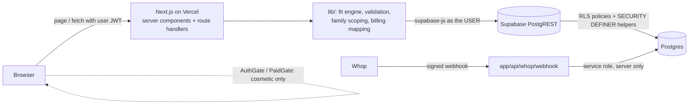

# Reviewer guide

For a senior developer opening this repo for the first time. About ten
minutes. Every claim links to the code, migration, test or evidence behind
it; if one is wrong, the link is where to look.

## 1. What it is, and how it is built

**Seeded** (https://seededtennis.com) helps junior tennis players and their
parents plan college recruiting: which college teams a player's UTR rating
realistically fits, plus their results, school list, coach outreach and
tournament plan. Players own their data; parents get a read-mostly family
view. Live, early, no public launch.

It is built by **one founder (a high-school student) working with Claude
Code**. Every change goes through a pull request, CI (`verify`: typecheck,
lint, tests, build), an independent review pass by a separate agent that is
told to break the change, and tests — many of them *guard tests* that fail
the build if a known bug or untrue claim comes back. Database changes are
rehearsed on a staging project and probed as real roles before production.
The process is documented in [GO-SEQUENCE.md](GO-SEQUENCE.md) and
[DECISIONS.md](DECISIONS.md); the rules every change follows are in
[../CLAUDE.md](../CLAUDE.md).

## 2. The 10-minute tour

| Open | Why |
|---|---|
| [`lib/fit.ts`](../lib/fit.ts) + [`lib/school-fit.ts`](../lib/school-fit.ts) | The product's core: the one fit engine every screen uses (see §6). |
| [`lib/db/family-scope.ts`](../lib/db/family-scope.ts) | How family data is scoped across the two membership shapes (see §5). |
| [`supabase/migrations/042_family_plan_lock.sql`](../supabase/migrations/042_family_plan_lock.sql) and [`045_family_plan_one_family_and_caps.sql`](../supabase/migrations/045_family_plan_one_family_and_caps.sql) | Representative migrations: the paid-plan lock enforced in RLS, with the reasoning in the file. |
| [`supabase/migrations/050_budget_writes_parents_only.sql`](../supabase/migrations/050_budget_writes_parents_only.sql) | A small, explained RLS fix with its rollback in the file (051, the newest, is the same shape as a trigger). |
| [`lib/db/family-scope.test.ts`](../lib/db/family-scope.test.ts) | A guard test: scans `app/`, `lib/`, `components/` and fails on any cross-user `profiles` read. |
| [`app/api/utr-entries/route.ts`](../app/api/utr-entries/route.ts) | A typical API route: request-scoped Supabase client (RLS applies), Postgres rate limit, zod validation. |
| [`app/api/whop/webhook/route.ts`](../app/api/whop/webhook/route.ts) | The only path that changes a user's paid tier (service role, signature-verified). |
| [`.github/workflows/ci.yml`](../.github/workflows/ci.yml) | What every PR must pass. |

## 3. How a request flows

The browser talks to Supabase with the signed-in user's own token, so Row
Level Security decides what every query can see or change. The service-role
key is used in the app only by the three Whop billing routes on the server —
`app/api/whop/webhook`, `/sync` and `/membership` (via
[`lib/supabase/admin.ts`](../lib/supabase/admin.ts) and
[`lib/whop-sync.ts`](../lib/whop-sync.ts)) — and outside the app by the
catalog importer (`scripts/import-rosters.ts`), which refuses to run against
production ([`lib/catalog/import-target.ts`](../lib/catalog/import-target.ts)).

## 4. The data model in one table

26 tables in `public`; **RLS is enabled on every one** (checked on production
2026-11-20). The main ones:

| Table | Owner | Who can read | Who can write | Key rule |
|---|---|---|---|---|
| `profiles` | the user | themself only (others' roster comes from `family_members()`, an enumerated column list) | themself, minus privileged columns | 022 trigger refuses client writes to tier, role, family code, billing ids, email-verification state |
| `utr_entries`, `matches`, `tournament_entries`, `coach_outreach`, `daily_checkins`, `cost_calculations`, `recruiting_checklist_items` | the player | the player; approved family members **only on the Family plan** | the player | `user_id = auth.uid()`; 042 `family_plan_required` ceiling on cross-member reads |
| `parent_accounts` | the family | members | only via `join_family()` / `approve_family_join()` / `remove_family_member()` / `leave_family()` RPCs | joiners land **pending** and read nothing until approved (026) |
| `families`, `family_codes` | the family | members | the creator's browser inserts the family row and its own code row at sign-up (`lib/auth.ts`); a code already taken is refused by `families`' UNIQUE constraint, and 032 stops a profile from claiming a taken code | joining always goes through `join_family()` (023) |
| `season_budgets`, `budget_expenses` | the family | approved members on the Family plan | **parents only** (050) | 042 lock + 050 role check |
| `encouragement_notes` | the parent who wrote it | the family on the Family plan; the author always | parents only (033) | |
| `training_plans`, `workout_sessions`, … | the player | the player | the player (manual calendar only) | |
| `rate_limit_events`, `family_join_attempts`, `auth_email_changes` | system | nobody (no policies) | SECURITY DEFINER functions only | |

Column-level truth is the generated [`lib/db/database.types.ts`](../lib/db/database.types.ts);
purpose and keys are in [DATABASE_SPEC.md](DATABASE_SPEC.md).

## 5. The security model

- **RLS first.** UI gates (`AuthGate`, `PaidGate`) only decide what to
  render; the database refuses everything else. A change to authorization
  starts by reading the live `pg_policies` ([SECURITY_CHECKLIST.md](SECURITY_CHECKLIST.md)).
- **Two family-membership shapes.** A family's creator carries the code on
  their own `profiles.family_code`; everyone who joins has an approved
  `parent_accounts` row and a NULL code (writing it was a takeover hole,
  closed in 022/032). Every helper — `my_family_code()`, `is_family_member()`,
  `shares_approved_family_with()` — answers across both shapes
  (`is_family_member()` since [023](../supabase/migrations/023_family_join_rpc.sql);
  the read policies and write stamping since
  [036](../supabase/migrations/036_family_membership_both_shapes.sql)), and
  the app never scopes by `profiles.family_code`
  ([`family-scope.ts`](../lib/db/family-scope.ts)).
- **Family-plan lock** ([042](../supabase/migrations/042_family_plan_lock.sql),
  [045](../supabase/migrations/045_family_plan_one_family_and_caps.sql)):
  members of a family see each other's data only while someone whose *home*
  family it is pays for the Family plan; one plan unlocks one family, at most
  4 players and 2 parents. Guard: [`family-plan-lock.test.ts`](../lib/db/family-plan-lock.test.ts).
- **Under-13 consent** ([030](../supabase/migrations/030_under13_parent_consent.sql)):
  a restrictive policy on 21 tables keeps an under-13 account inert until an
  adult in the family consents. `birth_year` is write-once. Its own
  `profiles` row stays editable (so the child can reach the waiting screen),
  but [051](../supabase/migrations/051_pending_consent_profile_writes.sql)
  refuses tennis and recruiting fields there until consent.
- **Parent email proof** ([043](../supabase/migrations/043_parent_email_verification.sql)):
  a parent must prove their *current* email (a fresh OTP/magic-link session
  or a verified Google identity — not `email_confirmed_at`, which production
  auto-confirms) before joining, approving or consenting.
- **Privileged columns** ([022](../supabase/migrations/022_lock_privileged_profile_columns.sql)):
  a trigger refuses client writes to tier, role, family code, billing ids and
  verification state. Pinned by [`email-verification-gate.test.ts`](../lib/db/email-verification-gate.test.ts).
- **Rate limits in Postgres** ([028](../supabase/migrations/028_api_rate_limits.sql),
  [034](../supabase/migrations/034_enforce_rate_limits_in_database.sql)):
  limits live inside the SQL function and fail closed, so a caller cannot
  raise its own ceiling.
- **Budget writes are parent-only** ([050](../supabase/migrations/050_budget_writes_parents_only.sql),
  2026-11-20). Probed on staging and production as eight personas; evidence
  in the PR. A known remaining gap is in §9.
- **Why source-scanning guard tests, and why they are mutation-tested.**
  Some rules cannot be checked by a unit test (SQL cannot run under Vitest;
  "never read another user's profile" is a property of every file). So tests
  read the code or the migrations and fail on the bad pattern. A guard that
  never fails is worthless, so each one is proven by re-introducing the bug.
  Real example: an independent reviewer added one scratch file that read
  `profiles` across users four different ways, including
  `.eq("family_code", code)`, and the first version of
  `family-scope.test.ts` stayed green. It was rewritten to the decidable rule
  ("every `profiles` chain is a single-row read by `.eq("id", …)`") and now
  fails on that file naming all four reasons. The same happened tonight to
  the 050 guard: the reviewer defeated it eight ways; all eight are now cases
  in [`budget-parent-only.test.ts`](../lib/db/budget-parent-only.test.ts).

## 6. The fit engine

- Four bands: **Likely / Target / Reach / Out of range**, explained on
  [/methodology](https://seededtennis.com/methodology). One path:
  `classifySchoolFit` in [`lib/school-fit.ts`](../lib/school-fit.ts), always
  given a projection that can return "out-of-range"
  ([`fit-band-consistency.test.ts`](../lib/fit-band-consistency.test.ts),
  [`fit-single-source.test.ts`](../lib/fit-single-source.test.ts)).
- Bands plan with **min(the player's own pace, 1.5 UTR/year)**
  (`PLANNING_PACE_CAP_PER_YEAR` in [`lib/fit.ts`](../lib/fit.ts)). A faster
  pace is shown only as a dashed "Estimate", never banded
  ([`pace-cap.test.ts`](../lib/pace-cap.test.ts),
  [`pace-honesty.test.ts`](../lib/pace-honesty.test.ts)).
- **No invented data.** Missing data shows "Not tracked". Team UTR ranges are
  labelled estimates with their source; invented coach names, emails and
  rankings were deleted and a test fails if they return
  ([`schools-catalog-honesty.test.ts`](../lib/db/schools-catalog-honesty.test.ts),
  [`no-invented-school-data.test.ts`](../lib/no-invented-school-data.test.ts),
  [`no-invented-goal.test.ts`](../lib/no-invented-goal.test.ts)).

## 7. Testing

| Layer | What | How to run |
|---|---|---|
| Unit | fit math, formatters, billing mapping, family view | `npm test` |
| Guard | source/SQL scanners for known-bad patterns and untrue copy (e.g. [`copy-honesty.test.ts`](../lib/copy-honesty.test.ts)) | `npm test` |
| Time zones | the whole suite in New York and Auckland | `npm run test:tz` |
| Browser harness | Playwright scripts: route audit, personas, keyboard, CLS, Lighthouse | [`scripts/README.md`](../scripts/README.md) (staging only) |
| RLS probes | SQL as `authenticated` + JWT claims in a block that always rolls back | [HANDOFF.md §J](HANDOFF.md) |

Counts on 2026-11-20 (night): **119 test files, 1,766 tests**, all passing in UTC,
New York and Auckland. CI runs typecheck, lint, the tests in all three zones and
the production build on every PR and every push to `main`.

## 8. Deployment and migrations

`main` auto-deploys to production with no staging gate, so the merge is the
release. Migrations ship **before** the code that needs them, each through
[GO-SEQUENCE.md](GO-SEQUENCE.md): fresh `pg_dump` backup → apply → probe as
real roles in rolled-back transactions → record the result in §J of
[HANDOFF.md](HANDOFF.md), which also holds a pasteable rollback per step.
Production ledger: check `list_migrations` (53 rows on 2026-11-21, through
051). Code rollback: Vercel Instant Rollback or a revert PR.

## 9. Known trade-offs and open debt (ranked)

1. **`Player.currentUTR` uses `0` as an in-memory "no rating" sentinel.**
   The database rejects 0, so writes convert it to NULL and every derived
   number checks `hasRealUtr()` first (guards:
   [`utr-sentinel.test.ts`](../lib/utr-sentinel.test.ts)). Risk: a new call
   site forgets. Plan: make it `number | null` (~79 sites) — [TODO.md](TODO.md).
2. **A player could get budget writes through a second "parent" account.**
   Role is chosen at sign-up and any approved member may approve a join, so a
   sibling can create a parent account and approve it. Visible on the roster,
   capped at 2 parents. Decided 2026-11-21, to build after this review: a
   player may approve only a family's first parent; after that only an
   approved parent approves parents, and Settings → Family shows who
   approved whom. A fake *first* parent stays possible and is accepted —
   [DECISIONS.md](DECISIONS.md), [TODO.md](TODO.md) "Who may approve a parent joiner".
3. **Large files.** `lib/fit.ts` (~1,310 lines), `lib/auth.ts` (~1,170),
   `components/seeded/schools/seeded-schools-browser.tsx` (~1,170),
   `components/auth/signup-flow.tsx` (~790), and the Today layout
   (`components/seeded/dashboard/seeded-dashboard-layout.tsx`). Suggested splits: fit →
   `projection.ts` / `bands.ts` / `pace.ts`; auth → `session.ts` /
   `profile-write.ts` / `family-signup.ts`; schools browser → filters,
   list, and row components plus a `useSchoolFilters` hook; signup-flow → one
   component per step. Not done yet because each touches guard-tested code
   and deserves its own reviewed PR.
4. **Catalog team UTR ranges are unverified estimates**, labelled as such.
   Phase 1 of a sourced catalog (PR E #9, merged 2026-11-20 behind a
   feature flag that is off; tables in production, no rows) adds the tables,
   an importer that refuses production, and an owner-only form; ranges must
   then be entered by hand from sources
   ([CATALOG_EXPANSION.md](CATALOG_EXPANSION.md)). The raw roster file it was
   built from (one row per student, ~1,900 real names) was in the repo from
   2026-11-20 to 2026-11-21; it is replaced by per-team counts, but it is
   still in git history until the owner decides on a purge ([TODO.md](TODO.md)).
5. **Auth rate limits and leaked-password protection are Supabase project
   settings**, not code (the browser calls Supabase Auth directly); they need
   a plan upgrade.
6. **Seeded sends no email yet.** "Remind them" only re-sorts a request; the
   copy says so and [`copy-honesty.test.ts`](../lib/copy-honesty.test.ts)
   forbids promising otherwise.
7. **The privacy policy needs an adult or lawyer review** before a public
   launch. Its mechanisms (export, real deletion, consent) exist and are tested.
8. **Post-checkout sync has never run since the redesign** — tier changes rely
   on the Whop webhook alone (the return URL loses its query). Decided
   2026-11-21: turn the re-check back on as a backup to the webhook, after
   this review ([TODO.md](TODO.md)).
9. **Smaller open items from the full sweep** (budget expenses can't be
   edited/deleted; a parent's /schools shows the parent's own empty list; two
   GPA rules) — [TODO.md](TODO.md) "Left open by the review-ready sweep".

## 10. What's next (after this review)

A full UI revamp; an AI goal coach that turns a player's goals into
year/month/week goals (V1 ships no AI); wiring the recruiting checklist into
Today; a weekly email (needs a real sending path first); catalog team
ranges from sources, then public SEO school pages. Order and status:
[MASTER_ROADMAP.md](MASTER_ROADMAP.md).
