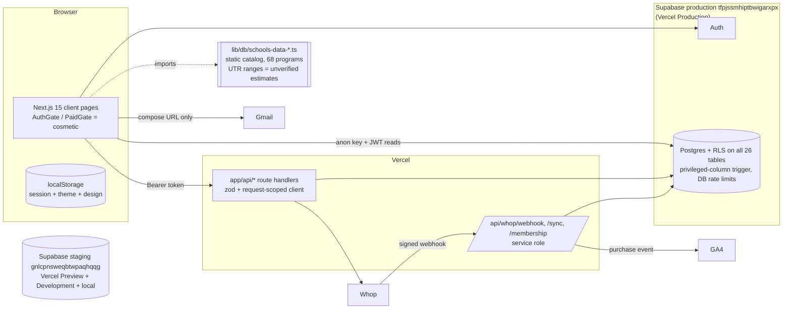

# System architecture (as built, 2026-11-20)

Production and staging are separate projects with the same schema (staging
also has migration 048). No AI provider, no Stripe, no email sender.

**Weak points still in this picture:** route protection is client-side (RLS
is the real gate); the catalog lives in code with no per-number source (PR E
/ migration 048 is the fix, staging only).
