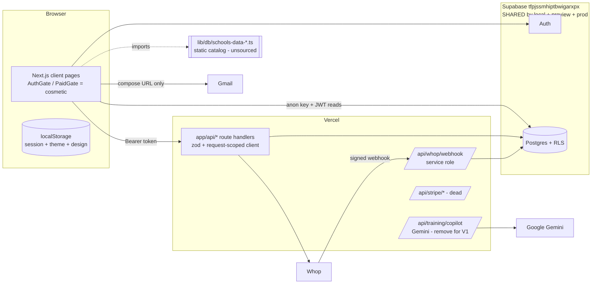

# System architecture (as built, 2026-11-10)

**Red flags in this picture:** one database for every environment; the catalog lives in code with no source; the browser can PATCH privileged profile columns directly (S-1).
